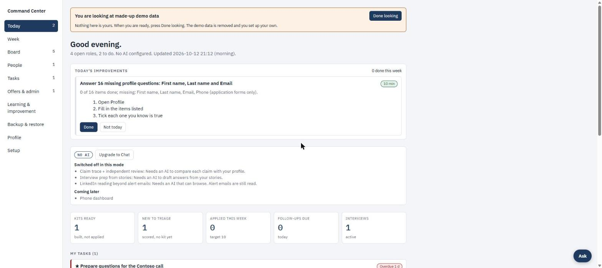
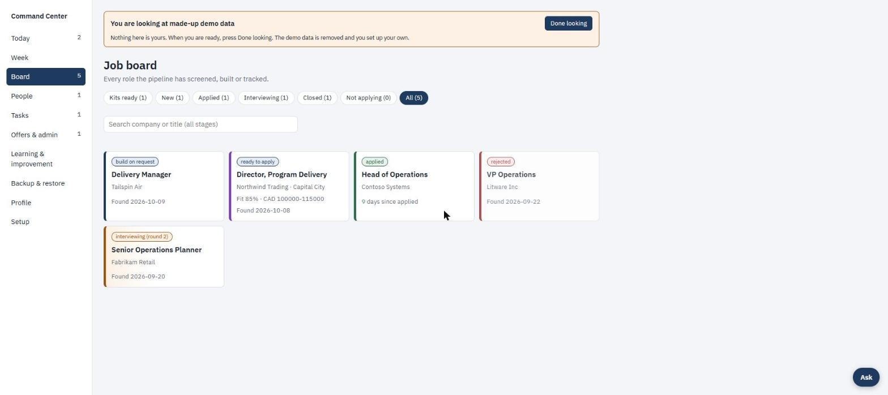

# 🧭 Command Center

**Your job search, on one page, on your own computer.**
It gathers roles, checks each against *your* rules, drafts a tailored resume, and gives you a daily to-do list.
Want a cover letter? It writes a short one-page one on request.

> 🛑 **It never applies, sends anything, logs in for you, or makes up a fact.**
> Your profile is the only source of facts, and everything stays in one private folder on your computer.

## 🚀 Install in 3 clicks (Windows 11)

1. **Code** → **Download ZIP**
2. Right-click the zip → **Extract All**, open the folder
3. Double-click **Install Command Center**
   (If Windows says "protected your PC": **More info** → **Run anyway**)

Wait for **ALL DONE**. Your browser opens the app. That takes a few minutes and about 1.5 GB of disk;
the installer checks first and changes nothing if there is not enough room.
Open it later from Start menu → **Command Center**.

🩹 Something wrong? [If setup fails](docs/TROUBLESHOOTING.md). Re-running the installer is always safe.
🐧 macOS, Linux or terminal? [Advanced install](docs/ADVANCED.md).

## 👋 First use

1. Choose **Try the demo** (a made-up candidate, removed in one click) or **Set up with my own data**.
2. Follow the steps in the [setup guide](docs/SETUP.md).
3. On any role press **Build kit** for a tailored resume, or **Cover letter** if you want one.

## 🤖 AI is optional

The default is **No AI**: free, and nothing leaves your computer. Cover letters need an AI mode.
Pick one later: paste prompts into any chatbot, or connect your own account (Claude, OpenAI, Gemini, Ollama and more).
[The four modes →](docs/MODES.md)

## 📚 More

[Setup](docs/SETUP.md) · [Modes](docs/MODES.md) · [Backup and restore](docs/BACKUP.md) ·
[Troubleshooting](docs/TROUBLESHOOTING.md) · [Advanced](docs/ADVANCED.md)

Needs Python 3.11+ and LibreOffice (for PDFs); the Windows installer adds both if missing. Developed on Windows 11;
macOS and Linux should work but are not regularly tested. The dashboard footer links back to this project; the MIT
licence lets you change anything, including that link.
